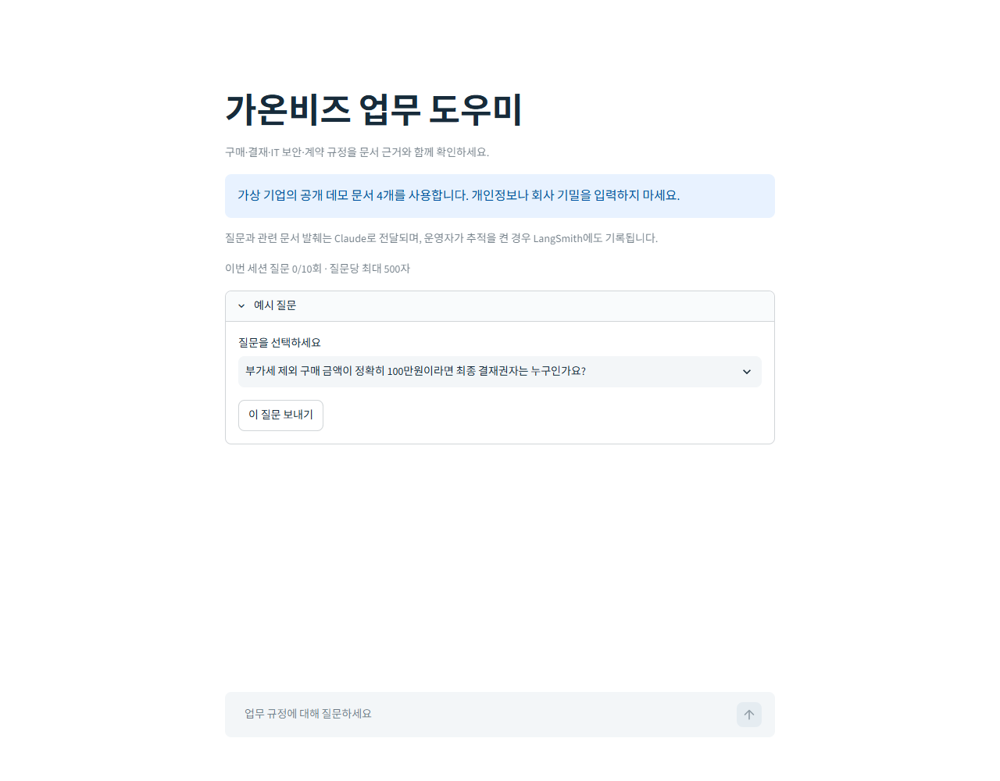

[English](README.md) | [한국어](README_ko.md)

# Enterprise RAG Assistant

A portfolio project for answering questions about business policies with retrieval-augmented generation (RAG). The Streamlit app searches a fixed PDF collection, generates Korean answers from retrieved evidence, and displays the source document, page, and excerpt.

The goal is to deliver a public Streamlit demo, source code, and measured evaluation results under the scope of a two-day MVP plan.

## Current status

**Phases 1–4 work locally. Phase 5 evaluation, tracing integration, and deployment preparation are implemented; public deployment and a real LangSmith trace remain pending. The ten-question baseline has 8/8 retrieval hits, 2/2 multi-document coverage, and 2/2 abstentions. Agent-reviewed correctness is 9/10; independent human review is pending.**

| Available now | Details |
| --- | --- |
| MVP specification | Requirements, architecture, implementation sequence, and acceptance criteria |
| Sample documents | Four Korean PDFs totaling 13 pages |
| Evaluation dataset | Ten questions with reference answers, alternative evidence, and manual grading criteria |
| Offline preprocessing | Four PDFs / 13 pages produce 22 chunks with source metadata |
| Indexing and retrieval | Persistent Chroma, compatible-index reuse, explicit rebuilds, and top-three retrieval |
| Local verification | 205 tests passed; covers Chroma, embeddings, Claude, citation validation, evaluation metrics, tracing failures, Streamlit, and portable index integrity |
| Real model retrieval | Local E5 model; q01/q07/q08 all cover their required evidence groups, including the original quotes |
| Grounded answers | `RAGAssistant.answer()` uses one retrieval and at most one Claude call; returns cited claims, original retrieval, and latency |
| Live Claude checks | q01/q07/q08 answered with matched quotes; q09/q10 abstained; partial/conflicting evidence and document instructions checked |
| Streamlit UI | Examples, chat history, source expanders, safe errors, and a ten-attempt session limit; three real browser questions verified |
| Phase 5 evaluation | Ten actual results, reproducible metrics, identified agent review, and a blank human review bound to the run |
| Deployment preparation | Portable precomputed-vector bundle and server settings; [deployment guide](DEPLOYMENT.md), public URL pending |
| Development phases | Five bilingual phase documents with dependencies and completion criteria |

`app.py` uses the verified `rag.py` pipeline; `grounding.py` validates claims and citations. `eval/evaluate.py` preserves all ten runs and recomputes metrics; `tracing.py` isolates optional LangSmith failures. See the [Phase 4](Phase/Phase4_StreamlitInterface.md) and [Phase 5 reports](Phase/Phase5_EvaluationAndDeployment.md) for current evidence. Target repository: [SoyeonAhn3/enterprise-rag](https://github.com/SoyeonAhn3/enterprise-rag). **No public demo URL has been verified.**

## Run locally

For a fresh checkout, run the following from the project root in PowerShell with Python 3.12 installed:

```powershell
py -3.12 -m venv .venv
.\.venv\Scripts\python.exe -m pip install -r requirements-dev.txt
.\.venv\Scripts\python.exe -X utf8 ingest.py --dry-run
.\.venv\Scripts\python.exe -X utf8 -m pytest -q
```

The dry run creates `data/chunks_preview.json` without API credentials or embedding requests. The current corpus produces **4 documents, 13 text pages, 0 skipped pages, and 22 chunks**. The preview is generated locally and excluded from Git.

Copy `.env.example` only if `.env` is absent. Indexing and retrieval need no API key. The first run downloads the public `intfloat/multilingual-e5-small` model into `data/embedding_models/` (about 487 MB locally); subsequent runs reuse it on CPU. Both `.env` and the model cache are ignored by Git.

```powershell
if (-not (Test-Path -LiteralPath .env)) {
    Copy-Item -LiteralPath .env.example -Destination .env
}

# No API key needed. The first build downloads the local model.
.\.venv\Scripts\python.exe -X utf8 ingest.py
.\.venv\Scripts\python.exe -X utf8 rag.py "부가세 제외 구매 금액이 정확히 100만원이라면 최종 결재권자는 누구인가요?"
.\.venv\Scripts\python.exe -X utf8 -m eval.check_retrieval
```

Use `ingest.py --rebuild` when PDFs, embedding model/dimensions, or chunk settings change, including migration from an old OpenAI index. A matching index is reused without loading the embedding model or embedding documents again. The default local model produces 384-dimensional vectors with `passage: ` and `query: ` prefixes. Configuration priority is environment → supplied server secrets → `.env` → defaults. After the initial download, set `EMBEDDING_LOCAL_FILES_ONLY=true` for offline loading; leave it `false` on a new machine until the model is cached.

The smoke check writes `data/retrieval_smoke.json` for q01/q07/q08, retaining all retrieved chunks and separately checking source pages and evidence quotes. The real local model passed all three checks, including offline fresh-process reload with document embedding disabled. For the fixed offline workflow, stop the application before rebuilding and restart its retriever afterwards; old inactive collections remain stored and are not queried.

Set `ANTHROPIC_API_KEY` locally for Claude, then run `.\.venv\Scripts\python.exe -X utf8 llm.py --check`. This checks model access without generating an answer. `ANTHROPIC_MODEL` defaults to `claude-sonnet-5-5`; calls have a 30-second timeout, zero automatic retries, and a configurable output limit of 2048 tokens by default. An OpenAI key cannot be used as a Claude key. [Anthropic does not provide embeddings](https://platform.claude.com/docs/en/build-with-claude/embeddings), so local search remains independent of Claude credentials.

```powershell
# One grounded answer; requires the configured Claude key and incurs API usage.
.\.venv\Scripts\python.exe -X utf8 rag.py --answer "부가세 제외 구매 금액이 정확히 100만원이라면 최종 결재권자는 누구인가요?"
# Five live questions; saves the complete result to data/answer_smoke.json.
.\.venv\Scripts\python.exe -X utf8 -m eval.check_answers
```

Without `--answer`, `rag.py` keeps its retrieval-only behavior. For Python integration, use `RAGAssistant(retriever, client).answer(question)` and close the caller-owned `Retriever` and `ClaudeClient` when finished; a full example is in the [Phase 3 report](Phase/Phase3_GroundedAnswers.md). Results include `answer`, `answerable`, claim-level quotes, validated `sources`, all `retrieved_chunks`, and search/generation/total latency. Initialization time is excluded.

Insufficient evidence returns exactly `등록된 문서에서 해당 정보를 확인할 수 없습니다.` with no cited sources. Provider failures and invalid output raise distinct exceptions instead of becoming successful abstentions. Quotes must match the retrieved text, ignoring whitespace only; filenames/pages come from stored metadata. Matching quotes establishes provenance, while semantic correctness still requires review.

## Start with the project materials

For the local chat interface, run:

```powershell
.\.venv\Scripts\python.exe -X utf8 -m streamlit run app.py
```

The server reads `.env` or Streamlit Secrets. Visitors never enter a key. On a fresh checkout, the app imports `deployment/index_bundle.json` without embedding documents, then downloads the public local query model once. A cached resource reuses the model/index/client. Each session allows ten attempts by default, including failures; provider-level budget controls are still needed for public sharing.



The [chat screenshot](docs/evidence/local-chat.png) shows real local answers, source excerpts, and abstention. Public Cloud setup, secrets, restart checks, and optional trace verification are described in [DEPLOYMENT.md](DEPLOYMENT.md).

1. Read the [MVP plan](plan/enterprise_rag_assistant_streamlit_mvp_plan.md) for the implementation requirements and planned deployment workflow.
2. Review the [sample-document guide](rag_mvp_sample_documents/README.md) for corpus details and evidence-matching rules.
3. Inspect the [runtime evaluation dataset](eval/questions.json) for the questions, reference answers, and grading criteria. The reviewed original remains in the sample-document folder.

The plan, document guide, PDFs, and evaluation content are written in Korean.

## Sample documents

The corpus describes purchasing, approvals, IT security, contracts, and settlement at the fictional company **Gaonbiz (가온비즈)**. All four documents use version `1.0` and the effective date `2026-09-01`.

| Document | ID | Pages | Coverage |
| --- | --- | ---: | --- |
| [Purchase requests and ordering](rag_mvp_sample_documents/01_purchase_process.pdf) | GB-PUR-01 | 3 | Requests, comparison quotes, purchase orders, and emergency purchases |
| [Approval authority and budget controls](rag_mvp_sample_documents/02_approval_budget.pdf) | GB-APR-02 | 3 | Approval thresholds, budget reviews, and aggregation of related purchases |
| [IT assets and SaaS security reviews](rag_mvp_sample_documents/03_it_security.pdf) | GB-SEC-03 | 3 | Prior security reviews, free trials, review timelines, and asset registration |
| [Contracts, acceptance, and settlement](rag_mvp_sample_documents/04_contract_settlement.pdf) | GB-CON-04 | 4 | Legal reviews, delivery acceptance, payment documents, and settlement schedules |

These are synthetic demonstration documents. Their policies and monetary thresholds do not describe a real company's rules and must not be used for actual purchasing or contracts.

## MVP architecture

The implemented pipeline uses **2-Step RAG: one retrieval step followed by answer generation**.

1. Extract each PDF page, split its text, and retain `source_file`, `page`, and `chunk_id` metadata.
2. Generate document embeddings and build a fixed Chroma index before deployment.
3. Embed a user's question and retrieve the top three relevant chunks.
4. Generate a Korean answer from the retrieved evidence, or abstain when the evidence is insufficient.
5. Display validated source references with filenames, 1-based page numbers, and excerpts.
6. Record retrieval and generation traces, then evaluate the application against the prepared questions.

Initial chunking settings are approximately **800 characters per chunk** with **120 characters of overlap**. These are starting settings from the plan, not measured optimal values.

| Area | Planned technology |
| --- | --- |
| Application and UI | Python, Streamlit |
| PDF extraction | PyMuPDF |
| RAG pipeline and chunking | LangChain, langchain-text-splitters |
| Vector index | Chroma, langchain-chroma |
| Embeddings | FastEmbed / ONNX Runtime, local multilingual E5 |
| Answer generation | Anthropic Claude API, official Python SDK |
| Tracing | LangSmith |
| Evaluation | Python, JSON, manual answer review |
| Deployment | Streamlit Community Cloud |

The application is verified locally on Windows / Python 3.12.10 with pinned dependencies. Streamlit 1.65.0 was added without replacing existing packages; `pip check` passes. LangSmith HTTP contracts and disabled/failing tracing are tested, but the real trace needs an operator key. Cloud compatibility, memory, model-cache startup, and public restart behavior remain unverified. The Linux Docker daemon was unavailable locally.

## Evaluation design

The dataset contains **six single-document questions, two multi-document questions, and two unanswerable questions**. It covers amount boundaries, deadlines, approval and review requirements, and abstention.

Each answerable question has `evidence_groups` for the facts needed to answer it. Groups are combined with **AND**; candidates within a group's `any_of` are combined with **OR**. Each candidate records `document`, `page`, and an original `quote`. A valid alternative source is accepted without requiring every alternative page.

For example, q07 requires both an approval-authority source and a security-review source. The security requirement can be supported by page 1 or page 3 of `03_it_security.pdf`.

| Planned measure | Definition |
| --- | --- |
| Retrieval Hit@3 | Among the eight answerable questions, the proportion with at least one accepted document/page in the top three retrieved chunks |
| Multi-document Coverage | For each of the two multi-document questions, whether every required evidence group has at least one candidate page in the top three |
| Answer Correctness | Manual assessment of all ten answers using the reference answers and `grading_criteria`, including whether key claims are supported by retrieved evidence |
| Abstention | Whether the application appropriately declines to answer the two questions whose answers are absent from the corpus |
| Latency | Mean response time across the ten questions |

Page matches alone do not establish that the relevant passage was retrieved. The actual chunks must also be reviewed for supporting evidence. `answer_keywords` are review aids, not an automatic correctness test.

**Do not index the evaluation dataset or send reference answers, evidence annotations, or grading criteria to generation.** A check forwards only the current question to RAG; retrieved PDF text supplies the evidence. Unanswerable questions have empty `evidence_groups`; they are excluded from retrieval and multi-document coverage measures, and an empty list does not count as successful evidence retrieval.

The Phase 2 smoke check measured q01/q07/q08 with real local E5. Phase 5 now records all ten questions below. This small synthetic dataset does not establish performance on real enterprise documents.

The [2026-10-14 baseline](eval/results/phase5_baseline.json) used `claude-sonnet-5-5` and the unchanged 22-chunk index. All ten requests completed without error. [Agent review](eval/results/phase5_agent_review.json) is explicitly distinguished from the pending [human review](eval/results/phase5_human_review.template.json).

| Measured result | Value |
| --- | --- |
| Retrieval Hit@3 / multi-document coverage | 8/8 / 2/2 |
| All required reference quotes retrieved | 8/8 |
| Unanswerable-question abstention | 2/2 |
| Mean RAG latency | 3326.96 ms, initialization excluded |
| Agent-reviewed correctness / grounding | 9/10 / 10/10 |

q08 gives the supported CFO/legal-review conclusion but omits the general threshold and explicit timing required by the full rubric. Those general clauses were not retrieved. It is recorded as incorrect under that rubric, rather than turning retrieval success into a correctness claim. No reference answers are sent to the model. See the [Phase 5 analysis](Phase/Phase5_EvaluationAndDeployment.md).

```powershell
# Ten new billable requests; checkpointed results use a new timestamped filename.
.\.venv\Scripts\python.exe -X utf8 -m eval.evaluate
# Offline recomputation; no API calls.
.\.venv\Scripts\python.exe -X utf8 -m eval.evaluate --report eval/results/phase5_baseline.json --review eval/results/phase5_agent_review.json
```

For tracing, set `LANGSMITH_TRACING=true` and `LANGSMITH_API_KEY` locally, then run `python -m eval.check_trace` with the project virtual environment. Missing/failed tracing does not block answers; the verifier requires remote retrieval/generation runs. The key and actual trace are currently absent.

## Development sequence and scope

The [MVP plan](plan/enterprise_rag_assistant_streamlit_mvp_plan.md) defines the scope. The missing Phase 4 prerequisite was completed during the requested Phase 5 work. Phase 5 stays in progress until human review, real tracing, and public deployment checks are complete.

| Phase | Goal | Status |
| --- | --- | --- |
| [1 — Foundation](Phase/Phase1_Foundation.md) | Verify the environment, fixed corpus, page metadata, and chunking | ✅ Completed; 35 tests passed |
| [2 — Indexing and retrieval](Phase/Phase2_IndexingAndRetrieval.md) | Build/reload a Chroma index and retrieve the top three chunks | ✅ Completed with real local embeddings |
| [3 — Grounded answers](Phase/Phase3_GroundedAnswers.md) | Generate supported answers, validate sources, and abstain | ✅ Completed with live Claude checks |
| [4 — Streamlit interface](Phase/Phase4_StreamlitInterface.md) | Provide chat, source display, loading/errors, and usage controls | ✅ Local browser verified |
| [5 — Evaluation and deployment](Phase/Phase5_EvaluationAndDeployment.md) | Measure ten questions, verify tracing, and publish the working demo | 🚧 Local evaluation/deployment preparation ready; remote gates pending |

The original two-day target maps Phases 1–4 to local operation on Day 1 and Phase 5 to evaluation/deployment on Day 2. Completion is based on verification evidence, not elapsed time. Each Phase document contains English first and Korean second.

The MVP uses a fixed corpus. User uploads, OCR, complex table recognition, authentication and document permissions, agentic or repeated retrieval, hybrid search, reranking, and long-term memory are outside the current scope.

## Current project structure

```text
Enterprise-rag/
├── Phase/
│   ├── Phase1_Foundation.md                 # ✅ Completed
│   ├── Phase2_IndexingAndRetrieval.md       # ✅ Local model acceptance complete
│   ├── Phase3_GroundedAnswers.md            # ✅ Grounded answers verified
│   ├── Phase4_StreamlitInterface.md         # ✅ Local browser verified
│   └── Phase5_EvaluationAndDeployment.md    # 🚧 Remote completion gates pending
├── .streamlit/                             # Theme and server-secret template
├── deployment/index_bundle.json            # Reviewed portable precomputed vectors
├── docs/evidence/                          # Actual local browser screenshots
├── documents/                              # Four runtime PDFs
├── eval/
│   ├── __init__.py
│   ├── check_retrieval.py                  # q01/q07/q08 retrieval smoke check
│   ├── check_answers.py                    # Five live grounded-answer checks
│   ├── evaluate.py                         # Ten-question runner and offline metrics
│   ├── check_trace.py                      # Read back actual LangSmith child runs
│   ├── results/                            # Baseline, metrics, agent/human review files
│   └── questions.json                      # Ten evaluation questions
├── plan/
│   └── enterprise_rag_assistant_streamlit_mvp_plan.md
├── rag_mvp_sample_documents/                # Reviewed source materials
├── tests/
│   ├── __init__.py
│   ├── fakes.py                            # Isolated test embeddings
│   ├── test_ingest.py
│   ├── test_config_and_embeddings.py
│   ├── test_claude.py
│   ├── test_index_and_retrieval.py
│   ├── test_retrieval_checks.py
│   ├── test_grounding.py
│   ├── test_answers.py
│   ├── test_answer_checks.py
│   ├── test_evaluation.py
│   ├── test_tracing.py
│   ├── test_deployment.py
│   └── test_app.py
├── app.py                                  # Korean Streamlit chat interface
├── app_runtime.py                          # Cached RAG resources and lifecycle
├── config.py
├── embeddings.py
├── deployment.py                           # Export/import/check portable index
├── tracing.py                              # Optional LangSmith spans
├── grounding.py                            # Prompt, strict JSON, citation validation
├── llm.py                                  # Claude backend and connection check
├── index_store.py
├── ingest.py                               # Preview, index build/reuse, rebuild
├── rag.py                                  # Retrieval and grounded answers (--answer)
├── .env.example
├── .gitignore
├── .python-version
├── requirements.txt
├── requirements-dev.txt
├── README.md
├── DEPLOYMENT.md                           # English/Korean deployment instructions
└── README_ko.md
```

`documents/` and `eval/questions.json` are runtime copies of the reviewed sample materials. Keep them aligned when data changes. Credentials, generated previews/check results, model downloads, the local Chroma database, and the virtual environment are excluded from Git.
