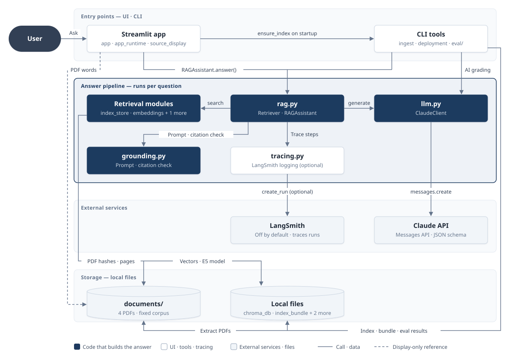
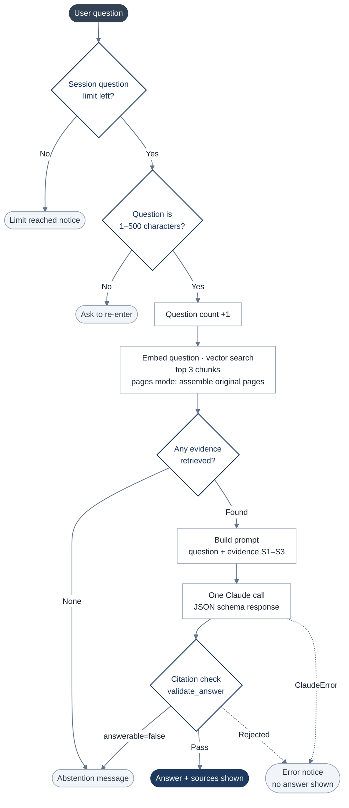
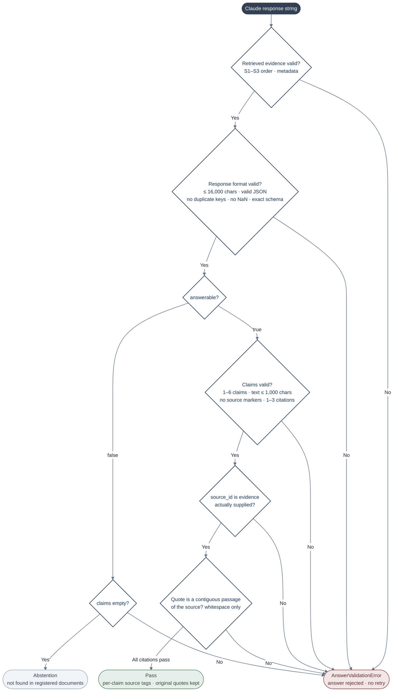
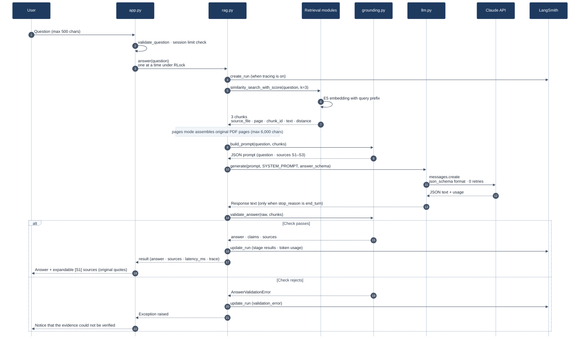

# Enterprise RAG Assistant Architecture

> A RAG demo that retrieves evidence from company policy PDFs, has Claude answer only from that evidence, and shows the answer only when every quote matches the original text

## 1. Overview — What is it made of?

- **Navy boxes**: code that runs for every question and builds the answer. If `grounding.py` cannot verify the citations, no answer reaches the screen.
- **Grouped boxes**: Streamlit app = `app.py` · `app_runtime.py` · `source_display.py`, CLI tools = `ingest.py` · `deployment.py` · `eval/`, Retrieval modules = `index_store.py` · `embeddings.py` · `retrieval_context.py`, Local files = `data/chroma_db` · `data/embedding_models` · `deployment/index_bundle.json` · `eval/results`
- The settings loader `config.py` (`.env` · Streamlit secrets) is read by every module, so it is left out of the diagram to keep the lines readable.

## 2. Workflow — How one question is processed

## 3. Citation Check Flow — How validate_answer decides whether to accept an answer

## 4. Data Flow — What moves in one question

