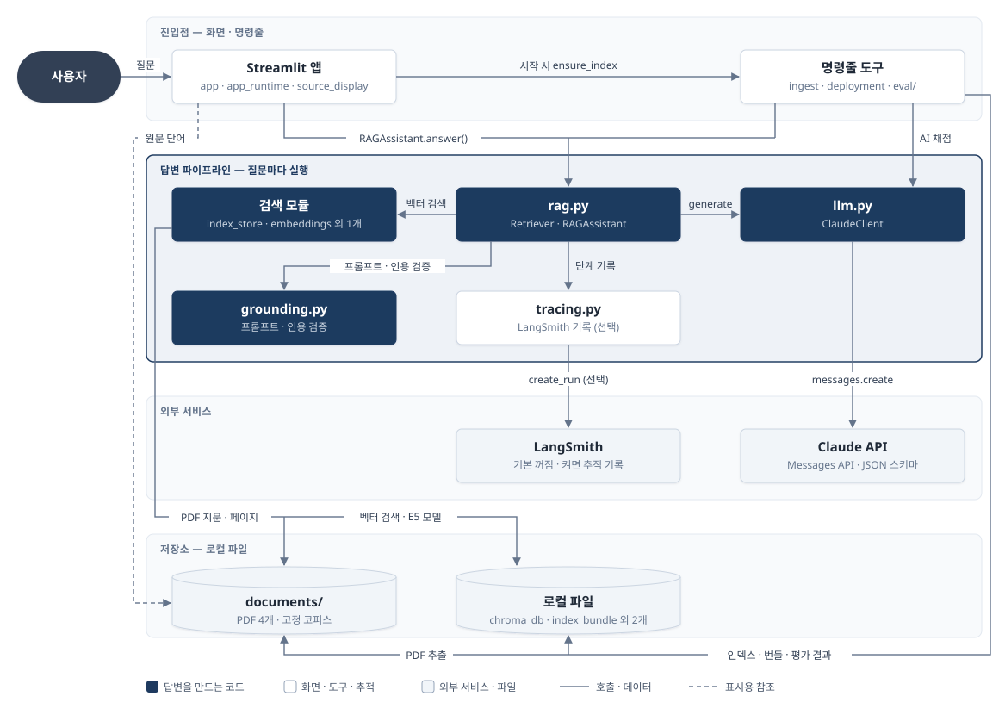
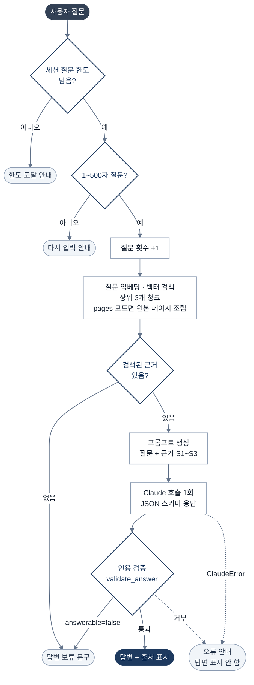
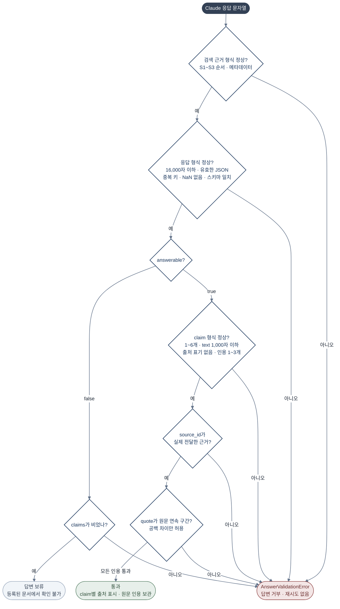
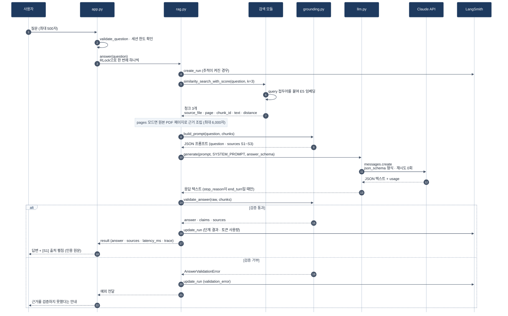

# Enterprise RAG Assistant 아키텍처

> 회사 규정 PDF에서 근거를 검색하고, Claude가 그 근거로만 답하게 한 뒤, 인용문이 실제 원문과 일치할 때만 답변을 보여 주는 RAG 데모

## 1. 구성도 — 무엇으로 이루어져 있나

- **네이비 박스**: 질문마다 실행되어 답변을 만드는 코드. `grounding.py`가 인용을 검증하지 못하면 답변을 화면에 내보내지 않습니다.
- **묶은 박스**: Streamlit 앱 = `app.py` · `app_runtime.py` · `source_display.py`, 명령줄 도구 = `ingest.py` · `deployment.py` · `eval/`, 검색 모듈 = `index_store.py` · `embeddings.py` · `retrieval_context.py`, 로컬 파일 = `data/chroma_db` · `data/embedding_models` · `deployment/index_bundle.json` · `eval/results`
- 모든 모듈이 읽는 설정 로더 `config.py`(`.env` · Streamlit secrets)는 선이 너무 많아져 그림에서 뺐습니다.

## 2. 작업 흐름 — 질문 하나가 처리되는 순서

## 3. 인용 검증 흐름 — validate_answer가 답변을 받아들일지 결정하는 방법

## 4. 데이터 흐름 — 질문 한 번에 무엇이 오가나

